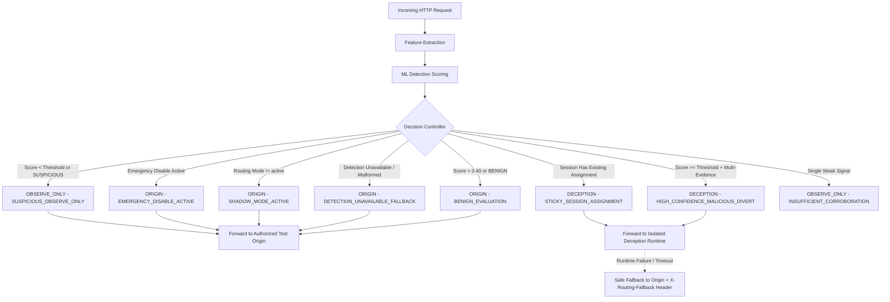

# Architecture Specification: AI-Enabled Adaptive Cyber Deception Gateway

## 1. System Overview

The **AI-Enabled Adaptive Cyber Deception Gateway** is a defensive cyber security platform designed to detect, mislead, and analyze adversaries in real time. Rather than simply blocking malicious traffic, the gateway uses machine learning to classify incoming session behavior and selectively diverts malicious actors into an isolated, high-interaction deception runtime (honeypots, decoy services, synthetic data). This exhausts attacker resources, collects high-fidelity threat intelligence, and prevents unauthorized access to genuine core assets without alerting the adversary.

---

## 2. High-Level System Architecture

```mermaid
flowchart TD
    subgraph UntrustedZone["Untrusted Network (External)"]
        Client["Incoming Client Traffic (Benign / Adversary)"]
    end

    subgraph DMZ["DMZ / Ingress Layer"]
        Gateway["Gateway Service<br/>Reverse-Proxy & Decision Controller<br/><i>gateway/ - Stage 2, 3, 5</i>"]
    end

    subgraph CoreZone["Core Application Zone (Authorized Network)"]
        Origin["Test Origin Service<br/>Authorized Application<br/><i>gateway/test-origin/</i>"]
        Backend["Backend Core API<br/>Node.js / Express / TypeScript<br/><i>backend/ - Stage 1</i>"]
        Frontend["Operator Dashboard & UI<br/>React / Vite<br/><i>frontend/ - Stage 1-5</i>"]
        DB[("PostgreSQL Database<br/>Events & Telemetry<br/><i>infra/ - Stage 1</i>")]
    end

    subgraph MLZone["Machine Learning Zone"]
        MLService["Detection Service<br/>Python ML Anomaly Engine<br/><i>detection/ - Stage 3</i>"]
    end

    subgraph DeceptionZone["Isolated Deception Zone (Strict Containment)"]
        DecoyEnv["Deception Runtime & DSG<br/>Stateful Honeypots & Decoy Services<br/><i>deception/ - Stage 4-5</i>"]
    end

    Client -->|HTTP/HTTPS Request| Gateway
    Gateway -->|Feature Extraction & Telemetry| MLService
    MLService -->|Threat Score & Classification| Gateway

    Gateway -->|Benign Traffic & Observe Only (Origin)| Origin
    Gateway -->|Policy-Controlled Diversion (Active Mode)| DecoyEnv
    Gateway -.->|Safe Fallback if Deception Fails| Origin

    Frontend -->|Admin & Status Queries| Backend
    Backend -->|Read/Write State| DB

    classDef active fill:#1b5e20,stroke:#4caf50,color:#fff;
    class Origin,Backend,Frontend,DB,Gateway,MLService,DecoyEnv active;
```

---

## 3. Service Responsibilities

### 3.1 `frontend/` (Stage 1-5 — Active)
- **Tech Stack:** React, JavaScript, Vite.
- **Role:** Web operator interface for monitoring system health, reviewing threat intelligence, and configuring gateway policies.
- **Stage 5 Scope:** Live operator dashboard displaying real-time gateway health, active routing mode (`shadow` vs `active`), emergency killswitch status, deception session counters, and service module readiness.

### 3.2 `backend/` (Stage 1 — Active)
- **Tech Stack:** Node.js, Express, TypeScript.
- **Role:** Central control plane, API provider, and telemetry coordinator.
- **Stage 1 Scope:** Health check service (`GET /health`), CORS support, structured graceful shutdown, and containerized deployment.

### 3.3 `gateway/` (Stage 2, Stage 3, Stage 5 — Active)
- **Tech Stack:** Node.js, Express, TypeScript reverse proxy.
- **Role:** Primary perimeter traffic ingress, feature extraction pipeline, and deterministic routing decision controller.
- **Stage 5 Policy-Controlled Traffic Diversion:**
  - **Deterministic Decision Controller (`controller.ts`):** Evaluates detection score, classification, multi-factor evidence, pseudonymous session identifier, routing mode, and emergency killswitch state. Outputs: `ORIGIN`, `DECEPTION`, or `OBSERVE_ONLY`.
  - **Conservative Defaults (Shadow Mode):** Default routing mode is `shadow`, ensuring zero traffic is diverted until explicitly opted into `active` mode.
  - **Sticky Session Router (`sessionRouter.ts`):** In-memory session tracking with sliding TTL (30 minutes) and LRU capacity eviction. Once a session is assigned to deception in active mode, subsequent requests remain sticky in the synthetic environment to maintain DSG state continuity.
  - **Safe Fail-Open & Degradation Resilience:**
    - If the Detection service is offline or times out, the gateway falls back safely to `ORIGIN` (`DETECTION_UNAVAILABLE_FALLBACK`).
    - If the Deception runtime is offline or crashes, the gateway automatically catches the error and executes an instant safe fallback to the authorized test origin, attaching `X-Routing-Fallback: deception-unavailable`.
  - **Emergency Killswitch:** Operational toggle (`POST /api/gateway/emergency-disable`) immediately halts all diversion and routes 100% of traffic to origin (`EMERGENCY_DISABLE_ACTIVE`).
  - **Spoofing Protection:** Strips all incoming client-supplied `X-Routing-*` and `X-Detection-*` headers.

### 3.4 `detection/` (Stage 3 — Active)
- **Tech Stack:** Python 3.11/3.14, FastAPI, Pydantic, Scikit-learn (RandomForestClassifier + StandardScaler), Uvicorn.
- **Role:** Real-time ML inference and behavioral risk scoring service (`POST /score`, `GET /health`).
- **Stage 3 Scope:**
  - Pydantic v2 data validation schemas (`RequestFeatures`, `DetectionResult`).
  - Deterministic explainable heuristic engine evaluating weighted multi-factor indicators (suspicious paths, SQLi/traversal keywords, frequency anomalies, high entropy).
  - Scikit-learn anomaly classifier trained on reproducible synthetic attack and benign distributions (`train.py`, `model.joblib`).
  - Dual-scoring ensemble outputting calibrated risk scores [0.0, 1.0], classification labels (`BENIGN`, `SUSPICIOUS`, `MALICIOUS`), and structured explainable evidence tags.
  - Zero host exposure; communicates exclusively across internal Docker bridge networks.

### 3.5 `deception/` (Stage 4-5 — Active)
- **Tech Stack:** Node.js, Express, TypeScript.
- **Role:** Isolated, stateful active cyber deception runtime and Deception State Graph (DSG).
- **Stage 4-5 Scope:**
  - Deception State Graph (DSG) with validated nodes (`entrypoint`, `catalog`, `users`, `files`, `admin`, `auth`) and strict transition boundaries.
  - Three-tier state architecture:
    1. *Protected Policy Layer:* Frozen, immutable safety constraints and operation allowlists.
    2. *Controlled Dynamic Layer:* Session-specific cloned synthetic records (users, files, services, decoy injection).
    3. *Observation Layer:* Pseudonymous session identifiers, visited nodes, telemetry timestamps, and interaction history.
  - Deterministic Deception Strategy Selector with policy assertion (`ADD_SYNTHETIC_DECOY_RECORD`, `EXPOSE_SYNTHETIC_SERVICE`, `INCREASE_OBSERVATION_DETAIL`, `MAINTAIN_CURRENT_STATE`, `DISABLE_DECEPTION`).
  - Synthetic APIs (`/api/catalog`, `/api/users`, `/api/files`, `/api/admin`, `/api/auth/login`) with zero access to real databases, host files, or real credentials.
  - Strictly containerized on internal Docker network (`deception-isolated-network`, port `5050`) with no published host port, unprivileged user `node`, sliding TTL session expiration, and LRU memory capacity controls.

### 3.6 `infra/` (Stage 1-5 — Active)
- **Tech Stack:** Docker, Docker Compose, PostgreSQL 16.
- **Role:** Declarative local and staging infrastructure management. Provides reproducible service orchestration and verified healthchecks across all 7 platform services.
- **Network Isolation:** Manages dual bridge networks: `deception-network` (interconnecting gateway, test-origin, detection, backend, frontend, postgres) and `deception-isolated-network` (connecting only gateway and deception runtime). Deception containers have zero physical routes to origin or database networks.

---

## 4. Trust Boundaries & Security Model

```
[ External Internet / Untrusted Zone ]
                 │
═════════════════╪═════════════════════════════════════════════════════════
 TRUST BOUNDARY 1: Perimeter Ingress (TLS Termination, Rate Limiting, WAF)
═════════════════╪═════════════════════════════════════════════════════════
                 ▼
       [ Gateway Reverse Proxy & Decision Controller ]
        /                                       \
       / (Benign or Observe-Only)                \ (High-Confidence Malicious)
      ▼                                           ▼
═════════════════════════             ═══════════════════════════════════════
 TRUST BOUNDARY 2: Core                TRUST BOUNDARY 3: Deception Isolation Barrier
 (Internal VPC / Auth)                 (Dedicated Docker Bridge: deception-isolated-network)
═════════════════════════             ═══════════════════════════════════════
      │                                                   │
      ▼                                                   ▼
 [ Test Origin / Backend / DB ]               [ Deception Honeypots & DSG ]
```

1. **Perimeter Boundary (Untrusted to DMZ):** Only the Gateway service exposes public ports (`8080`). No internal backend services, databases, or deception containers are accessible directly from the public network.
2. **Core Boundary (DMZ to Internal Services):** Backend APIs and ML detection services communicate only with verified internal clients over private Docker bridge networks.
3. **Deception Isolation Boundary (Containment):** The deception runtime is strictly isolated on `deception-isolated-network`. It has zero network routes to the test-origin, backend, database, or host system. Egress logging is asynchronous and unidirectionally sanitized.

---

## 5. Decision Controller & Traffic Routing Policies

### 5.1 Routing Evaluation State Machine



### 5.2 Routing Targets and Response Headers

| Decision Target | Route Destination | Description | Key Response Headers |
|---|---|---|---|
| `ORIGIN` | `ORIGIN_URL` (`http://test-origin:5000`) | Benign traffic, shadow mode execution, or safe fallback | `X-Routing-Decision: ORIGIN`<br/>`X-Routing-Reason: ...`<br/>`X-Origin-ID: authorized-test-origin` |
| `OBSERVE_ONLY` | `ORIGIN_URL` (`http://test-origin:5000`) | Suspicious or uncertain traffic routed to origin with telemetry | `X-Routing-Decision: OBSERVE_ONLY`<br/>`X-Routing-Reason: SUSPICIOUS_OBSERVE_ONLY` |
| `DECEPTION` | `DECEPTION_SERVICE_URL` (`http://deception:5050`) | Confirmed malicious attacker session diverted to synthetic DSG | `X-Routing-Decision: DECEPTION`<br/>`X-Routing-Reason: HIGH_CONFIDENCE_MALICIOUS_DIVERT`<br/>`X-Deception-Runtime: active`<br/>`X-DSG-Current-Node: ...` |

---

## 6. Staged Implementation Plan

| Stage | Focus Area | Deliverables | Current Status |
|---|---|---|---|
| **Stage 1** | **Repository Foundation & Architecture** | Modular directory layout, minimal React frontend, Express TypeScript backend with `GET /health`, Docker Compose orchestration, PostgreSQL healthcheck, architecture documentation. | **Active / Complete** |
| **Stage 2** | **Gateway & Traffic Interception** | Reverse-proxy service in `gateway/`, request inspection pipeline, routing policies, configurable routing rules, isolated test origin. | **Active / Complete** |
| **Stage 3** | **ML Detection Engine & Gateway Integration** | Python FastAPI ML service in `detection/`, feature extraction, dual deterministic + scikit-learn models, shadow mode gateway integration, fail-open resilience. | **Active / Complete** |
| **Stage 4** | **Dynamic Deception Runtime & DSG** | Isolated Node.js/TypeScript deception service in `deception/`, Deception State Graph (DSG), three logical state layers, deterministic strategy selector, session-isolated synthetic APIs. | **Active / Complete** |
| **Stage 5** | **Policy-Controlled Traffic Diversion** | Deterministic decision controller, configurable routing modes (`shadow`/`active`), sticky session router with sliding TTL, safe fallback resilience, dedicated isolated deception network, operator emergency killswitch. | **Active / Complete** |

---

## 7. Current State & Known Limitations (Stage 5)

- **Controlled Origin Scope:** Traffic diversion operates exclusively on the registered local test origin application (`http://test-origin:5000`) and internal deception runtime (`http://deception:5050`). Live production traffic and public internet domains are strictly prohibited.
- **Conservative Default Mode:** The default deployment mode is `shadow` mode (`ROUTING_MODE=shadow`). Diversion requires explicit operational activation (`ROUTING_MODE=active`).
- **In-Memory Session Store:** Active deception session stickiness is maintained using an in-memory sliding TTL store with LRU capacity limits (5,000 sessions).
- **Synthetic Data Boundaries:** All synthetic users, files, and services in the deception environment are mocked fixtures. No real credentials, production data, or host filesystem paths are reachable.

