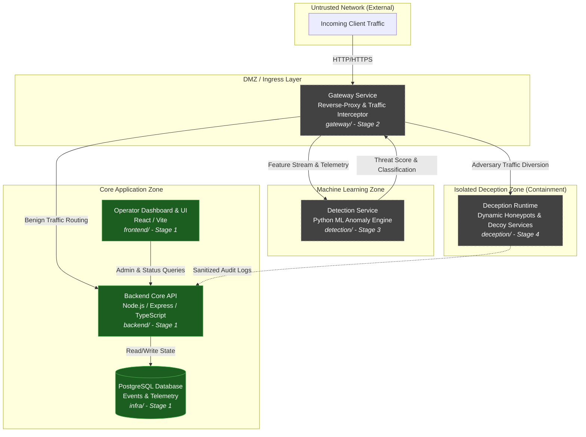

# Architecture Specification: AI-Enabled Adaptive Cyber Deception Gateway

## 1. System Overview

The **AI-Enabled Adaptive Cyber Deception Gateway** is a defensive cyber security platform designed to detect, mislead, and analyze adversaries in real time. Rather than simply blocking malicious traffic, the gateway uses machine learning to classify incoming session behavior and selectively diverts malicious actors into an isolated, high-interaction deception runtime (honeypots, decoy services, synthetic data). This exhausts attacker resources, collects high-fidelity threat intelligence, and prevents unauthorized access to genuine core assets without alerting the adversary.

---

## 2. High-Level System Architecture



---

## 3. Service Responsibilities

### 3.1 `frontend/` (Stage 1 — Active)
- **Tech Stack:** React, JavaScript, Vite.
- **Role:** Web operator interface for monitoring system health, reviewing threat intelligence, and configuring gateway policies.
- **Stage 1 Scope:** Minimal landing page displaying live backend connection status, module readiness status, and system metadata.

### 3.2 `backend/` (Stage 1 — Active)
- **Tech Stack:** Node.js, Express, TypeScript.
- **Role:** Central control plane, API provider, and telemetry coordinator.
- **Stage 1 Scope:** Health check service (`GET /health`), CORS support, structured graceful shutdown, and containerized deployment.

### 3.3 `gateway/` (Stage 2 — Reserved)
- **Tech Stack:** Reverse proxy (e.g., Envoy, OpenResty, or Node/Go proxy).
- **Role:** Primary traffic ingress. Intercepts HTTP/S requests, extracts behavioral features (headers, timing, payload entropy, path anomalies), queries the ML detection engine, and conditionally proxies requests to either genuine services or the deception runtime.

### 3.4 `detection/` (Stage 3 — Reserved)
- **Tech Stack:** Python (FastAPI/gRPC, PyTorch / Scikit-learn).
- **Role:** Real-time ML inference engine. Evaluates session telemetry, detects zero-day anomalies, recognizes known exploit signatures, and provides continuous threat scoring with confidence intervals.

### 3.5 `deception/` (Stage 4 — Reserved)
- **Tech Stack:** Containerized shadow runtimes, dynamic mock services, synthetic databases, and canary tokens.
- **Role:** Absorbs diverted attacker traffic. Provides realistic, believable interactions while strictly confining network egress to prevent pivot attacks.

### 3.6 `infra/` (Stage 1 — Active)
- **Tech Stack:** Docker, Docker Compose, PostgreSQL 16.
- **Role:** Declarative local and staging infrastructure management. Provides reproducible service orchestration and verified healthchecks.

---

## 4. Trust Boundaries & Security Model

```
[ External Internet / Untrusted Zone ]
                 │
═════════════════╪═════════════════════════════════════════════════════════
 TRUST BOUNDARY 1: Perimeter Ingress (TLS Termination, Rate Limiting, WAF)
═════════════════╪═════════════════════════════════════════════════════════
                 ▼
       [ Gateway Reverse Proxy ]
        /                     \
       / (Benign)              \ (Malicious / Suspected)
      ▼                         ▼
═════════════════════════   ═══════════════════════════════════════════════
 TRUST BOUNDARY 2: Core      TRUST BOUNDARY 3: Deception Isolation Barrier
 (Internal VPC / Auth)       (Air-gapped Sandbox / Egress Zero-Trust)
═════════════════════════   ═══════════════════════════════════════════════
      │                                 │
      ▼                                 ▼
 [ Backend & Database ]        [ Deception Honeypots ]
```

1. **Perimeter Boundary (Untrusted to DMZ):** Only the Gateway service exposes public ports. No internal backend services or databases are accessible directly from the public network.
2. **Core Boundary (DMZ to Internal Services):** Backend APIs communicate only with verified internal clients over private Docker bridge networks.
3. **Deception Isolation Boundary (Containment):** The deception runtime is strictly isolated from core production systems. Deception containers have zero outbound network routes to internal subnets or the wider internet to prevent pivot/lateral movement attacks. Egress logging is asynchronous and unidirectionally sanitized.

---

## 5. Request & Data Flows

### 5.1 Benign Traffic Flow (Normal Path)
1. User sends request to Gateway.
2. Gateway extracts request metadata and queries Detection service.
3. Detection service evaluates threat score (`score < threshold`).
4. Gateway forwards request unchanged to genuine `backend/` service.
5. `backend/` processes request and returns response through Gateway to user.

### 5.2 Malicious Traffic Flow (Deception Path)
1. Adversary executes scanning, SQL injection, path traversal, or credential stuffing against Gateway.
2. Gateway streams request features to Detection service.
3. Detection service identifies anomalous or malicious signature (`score >= threshold`).
4. Gateway transparently diverts session to `deception/` honeypot environment.
5. Honeypot returns realistic synthetic responses (e.g. mock admin dashboards, fake database errors, canary files).
6. Attacker interactions are logged for forensic analysis.

---

## 6. Staged Implementation Plan

| Stage | Focus Area | Deliverables | Current Status |
|---|---|---|---|
| **Stage 1** | **Repository Foundation & Architecture** | Modular directory layout, minimal React frontend, Express TypeScript backend with `GET /health`, Docker Compose orchestration, PostgreSQL healthcheck, architecture documentation. | **Active / Complete** |
| **Stage 2** | **Gateway & Traffic Interception** | Reverse-proxy service in `gateway/`, request inspection pipeline, routing policies, configurable routing rules. | *Reserved* |
| **Stage 3** | **ML Detection Engine** | Python ML service in `detection/`, feature extraction, anomaly detection model, scoring API, session context tracking. | *Reserved* |
| **Stage 4** | **Dynamic Deception Runtime** | Sandboxed honeypot containers in `deception/`, decoy targets, canary token generator, lateral egress barriers. | *Reserved* |
| **Stage 5** | **Dashboard, Telemetry & SIEM** | Interactive threat visualization in `frontend/`, attack graph replay, alert notifications, SIEM event export. | *Reserved* |

---

## 7. Current State & Known Limitations (Stage 1)

- **Authentication & Authorization:** Not yet implemented.
- **Database Schemas:** PostgreSQL container runs and passes healthcheck, but application tables/migrations will be introduced in subsequent stages.
- **Traffic Routing:** Gateway directory is reserved; requests are directly accessible to individual services in local development.
- **ML Detection & Honeypots:** No ML models or dynamic honeypot traps exist in Stage 1; no fake metrics are displayed.
