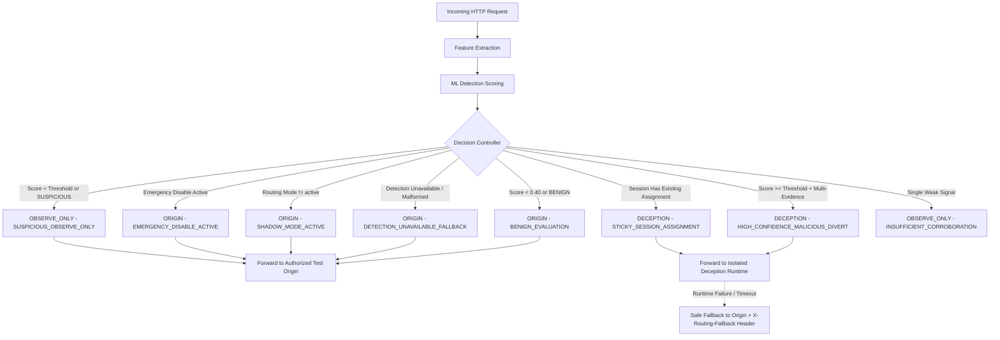
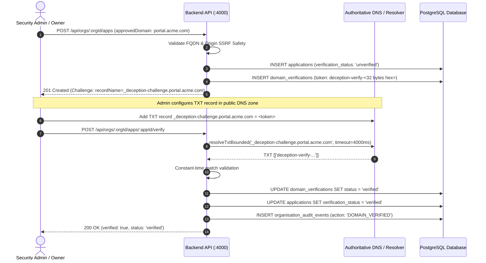
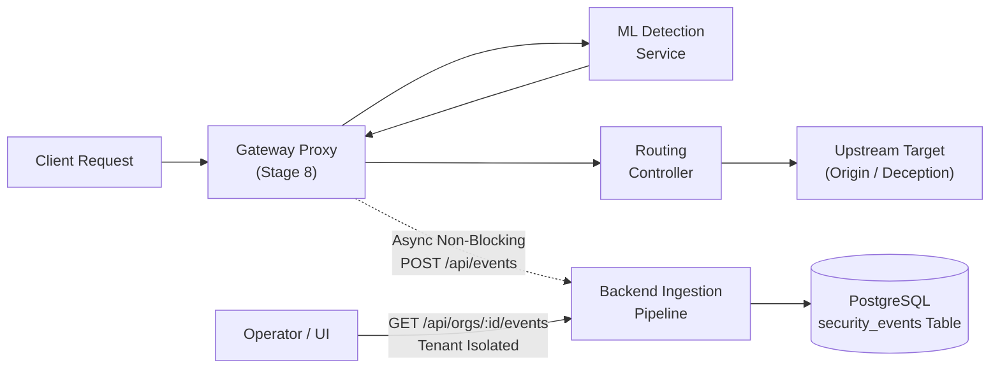

# Architecture Specification: AI-Enabled Adaptive Cyber Deception Gateway

## 1. System Overview

The **AI-Enabled Adaptive Cyber Deception Gateway** is a defensive cyber security platform designed to detect, mislead, and analyze adversaries in real time. Rather than simply blocking malicious traffic, the gateway uses machine learning to classify incoming session behavior and selectively diverts malicious actors into an isolated, high-interaction deception runtime (honeypots, decoy services, synthetic data). This exhausts attacker resources, collects high-fidelity threat intelligence, and prevents unauthorized access to genuine core assets without alerting the adversary.

---

## 2. High-Level System Architecture

```mermaid
flowchart TD
    subgraph UntrustedZone["Untrusted Network (External)"]
        Client["Incoming Client Traffic (Benign / Adversary)"]
    end

    subgraph DMZ["DMZ / Ingress Layer"]
        Gateway["Gateway Service<br/>Reverse-Proxy & Decision Controller<br/><i>gateway/ - Stage 2, 3, 5</i>"]
    end

    subgraph CoreZone["Core Application Zone (Authorized Network)"]
        Origin["Test Origin Service<br/>Authorized Application<br/><i>gateway/test-origin/</i>"]
        Backend["Backend Core API<br/>Node.js / Express / TypeScript<br/><i>backend/ - Stage 1</i>"]
        Frontend["Operator Dashboard & UI<br/>React / Vite<br/><i>frontend/ - Stage 1-5</i>"]
        DB[("PostgreSQL Database<br/>Events & Telemetry<br/><i>infra/ - Stage 1</i>")]
    end

    subgraph MLZone["Machine Learning Zone"]
        MLService["Detection Service<br/>Python ML Anomaly Engine<br/><i>detection/ - Stage 3</i>"]
    end

    subgraph DeceptionZone["Isolated Deception Zone (Strict Containment)"]
        DecoyEnv["Deception Runtime & DSG<br/>Stateful Honeypots & Decoy Services<br/><i>deception/ - Stage 4-5</i>"]
    end

    Client -->|HTTP/HTTPS Request| Gateway
    Gateway -->|Feature Extraction & Telemetry| MLService
    MLService -->|Threat Score & Classification| Gateway

    Gateway -->|Benign Traffic & Observe Only (Origin)| Origin
    Gateway -->|Policy-Controlled Diversion (Active Mode)| DecoyEnv
    Gateway -.->|Safe Fallback if Deception Fails| Origin

    Frontend -->|Admin & Status Queries| Backend
    Backend -->|Read/Write State| DB

    classDef active fill:#1b5e20,stroke:#4caf50,color:#fff;
    class Origin,Backend,Frontend,DB,Gateway,MLService,DecoyEnv active;
```

---

## 3. Service Responsibilities

### 3.1 `frontend/` (Stage 1-5 — Active)
- **Tech Stack:** React, JavaScript, Vite.
- **Role:** Web operator interface for monitoring system health, reviewing threat intelligence, and configuring gateway policies.
- **Stage 5 Scope:** Live operator dashboard displaying real-time gateway health, active routing mode (`shadow` vs `active`), emergency killswitch status, deception session counters, and service module readiness.

### 3.2 `backend/` (Stage 1 — Active)
- **Tech Stack:** Node.js, Express, TypeScript.
- **Role:** Central control plane, API provider, and telemetry coordinator.
- **Stage 1 Scope:** Health check service (`GET /health`), CORS support, structured graceful shutdown, and containerized deployment.

### 3.3 `gateway/` (Stage 2, Stage 3, Stage 5 — Active)
- **Tech Stack:** Node.js, Express, TypeScript reverse proxy.
- **Role:** Primary perimeter traffic ingress, feature extraction pipeline, and deterministic routing decision controller.
- **Stage 5 Policy-Controlled Traffic Diversion:**
  - **Deterministic Decision Controller (`controller.ts`):** Evaluates detection score, classification, multi-factor evidence, pseudonymous session identifier, routing mode, and emergency killswitch state. Outputs: `ORIGIN`, `DECEPTION`, or `OBSERVE_ONLY`.
  - **Conservative Defaults (Shadow Mode):** Default routing mode is `shadow`, ensuring zero traffic is diverted until explicitly opted into `active` mode.
  - **Sticky Session Router (`sessionRouter.ts`):** In-memory session tracking with sliding TTL (30 minutes) and LRU capacity eviction. Once a session is assigned to deception in active mode, subsequent requests remain sticky in the synthetic environment to maintain DSG state continuity.
  - **Safe Fail-Open & Degradation Resilience:**
    - If the Detection service is offline or times out, the gateway falls back safely to `ORIGIN` (`DETECTION_UNAVAILABLE_FALLBACK`).
    - If the Deception runtime is offline or crashes, the gateway automatically catches the error and executes an instant safe fallback to the authorized test origin, attaching `X-Routing-Fallback: deception-unavailable`.
  - **Emergency Killswitch:** Operational toggle (`POST /api/gateway/emergency-disable`) immediately halts all diversion and routes 100% of traffic to origin (`EMERGENCY_DISABLE_ACTIVE`).
  - **Spoofing Protection:** Strips all incoming client-supplied `X-Routing-*` and `X-Detection-*` headers.

### 3.4 `detection/` (Stage 3 — Active)
- **Tech Stack:** Python 3.11/3.14, FastAPI, Pydantic, Scikit-learn (RandomForestClassifier + StandardScaler), Uvicorn.
- **Role:** Real-time ML inference and behavioral risk scoring service (`POST /score`, `GET /health`).
- **Stage 3 Scope:**
  - Pydantic v2 data validation schemas (`RequestFeatures`, `DetectionResult`).
  - Deterministic explainable heuristic engine evaluating weighted multi-factor indicators (suspicious paths, SQLi/traversal keywords, frequency anomalies, high entropy).
  - Scikit-learn anomaly classifier trained on reproducible synthetic attack and benign distributions (`train.py`, `model.joblib`).
  - Dual-scoring ensemble outputting calibrated risk scores [0.0, 1.0], classification labels (`BENIGN`, `SUSPICIOUS`, `MALICIOUS`), and structured explainable evidence tags.
  - Zero host exposure; communicates exclusively across internal Docker bridge networks.

### 3.5 `deception/` (Stage 4-5 — Active)
- **Tech Stack:** Node.js, Express, TypeScript.
- **Role:** Isolated, stateful active cyber deception runtime and Deception State Graph (DSG).
- **Stage 4-5 Scope:**
  - Deception State Graph (DSG) with validated nodes (`entrypoint`, `catalog`, `users`, `files`, `admin`, `auth`) and strict transition boundaries.
  - Three-tier state architecture:
    1. *Protected Policy Layer:* Frozen, immutable safety constraints and operation allowlists.
    2. *Controlled Dynamic Layer:* Session-specific cloned synthetic records (users, files, services, decoy injection).
    3. *Observation Layer:* Pseudonymous session identifiers, visited nodes, telemetry timestamps, and interaction history.
  - Deterministic Deception Strategy Selector with policy assertion (`ADD_SYNTHETIC_DECOY_RECORD`, `EXPOSE_SYNTHETIC_SERVICE`, `INCREASE_OBSERVATION_DETAIL`, `MAINTAIN_CURRENT_STATE`, `DISABLE_DECEPTION`).
  - Synthetic APIs (`/api/catalog`, `/api/users`, `/api/files`, `/api/admin`, `/api/auth/login`) with zero access to real databases, host files, or real credentials.
  - Strictly containerized on internal Docker network (`deception-isolated-network`, port `5050`) with no published host port, unprivileged user `node`, sliding TTL session expiration, and LRU memory capacity controls.

### 3.6 `infra/` (Stage 1-5 — Active)
- **Tech Stack:** Docker, Docker Compose, PostgreSQL 16.
- **Role:** Declarative local and staging infrastructure management. Provides reproducible service orchestration and verified healthchecks across all 7 platform services.
- **Network Isolation:** Manages dual bridge networks: `deception-network` (interconnecting gateway, test-origin, detection, backend, frontend, postgres) and `deception-isolated-network` (connecting only gateway and deception runtime). Deception containers have zero physical routes to origin or database networks.

---

## 4. Trust Boundaries & Security Model

```
[ External Internet / Untrusted Zone ]
                 │
═════════════════╪═════════════════════════════════════════════════════════
 TRUST BOUNDARY 1: Perimeter Ingress (TLS Termination, Rate Limiting, WAF)
═════════════════╪═════════════════════════════════════════════════════════
                 ▼
       [ Gateway Reverse Proxy & Decision Controller ]
        /                                       \
       / (Benign or Observe-Only)                \ (High-Confidence Malicious)
      ▼                                           ▼
═════════════════════════             ═══════════════════════════════════════
 TRUST BOUNDARY 2: Core                TRUST BOUNDARY 3: Deception Isolation Barrier
 (Internal VPC / Auth)                 (Dedicated Docker Bridge: deception-isolated-network)
═════════════════════════             ═══════════════════════════════════════
      │                                                   │
      ▼                                                   ▼
 [ Test Origin / Backend / DB ]               [ Deception Honeypots & DSG ]
```

1. **Perimeter Boundary (Untrusted to DMZ):** Only the Gateway service exposes public ports (`8080`). No internal backend services, databases, or deception containers are accessible directly from the public network.
2. **Core Boundary (DMZ to Internal Services):** Backend APIs and ML detection services communicate only with verified internal clients over private Docker bridge networks.
3. **Deception Isolation Boundary (Containment):** The deception runtime is strictly isolated on `deception-isolated-network`. It has zero network routes to the test-origin, backend, database, or host system. Egress logging is asynchronous and unidirectionally sanitized.

---

## 5. Decision Controller & Traffic Routing Policies

### 5.1 Routing Evaluation State Machine



### 5.2 Routing Targets and Response Headers

| Decision Target | Route Destination | Description | Key Response Headers |
|---|---|---|---|
| `ORIGIN` | `ORIGIN_URL` (`http://test-origin:5000`) | Benign traffic, shadow mode execution, or safe fallback | `X-Routing-Decision: ORIGIN`<br/>`X-Routing-Reason: ...`<br/>`X-Origin-ID: authorized-test-origin` |
| `OBSERVE_ONLY` | `ORIGIN_URL` (`http://test-origin:5000`) | Suspicious or uncertain traffic routed to origin with telemetry | `X-Routing-Decision: OBSERVE_ONLY`<br/>`X-Routing-Reason: SUSPICIOUS_OBSERVE_ONLY` |
| `DECEPTION` | `DECEPTION_SERVICE_URL` (`http://deception:5050`) | Confirmed malicious attacker session diverted to synthetic DSG | `X-Routing-Decision: DECEPTION`<br/>`X-Routing-Reason: HIGH_CONFIDENCE_MALICIOUS_DIVERT`<br/>`X-Deception-Runtime: active`<br/>`X-DSG-Current-Node: ...` |

---

## 6. Staged Implementation Plan

| Stage | Focus Area | Deliverables | Current Status |
|---|---|---|---|
| **Stage 1** | **Repository Foundation & Architecture** | Modular directory layout, minimal React frontend, Express TypeScript backend with `GET /health`, Docker Compose orchestration, PostgreSQL healthcheck, architecture documentation. | **Active / Complete** |
| **Stage 2** | **Gateway & Traffic Interception** | Reverse-proxy service in `gateway/`, request inspection pipeline, routing policies, configurable routing rules, isolated test origin. | **Active / Complete** |
| **Stage 3** | **ML Detection Engine & Gateway Integration** | Python FastAPI ML service in `detection/`, feature extraction, dual deterministic + scikit-learn models, shadow mode gateway integration, fail-open resilience. | **Active / Complete** |
| **Stage 4** | **Dynamic Deception Runtime & DSG** | Isolated Node.js/TypeScript deception service in `deception/`, Deception State Graph (DSG), three logical state layers, deterministic strategy selector, session-isolated synthetic APIs. | **Active / Complete** |
| **Stage 5** | **Policy-Controlled Traffic Diversion** | Deterministic decision controller, configurable routing modes (`shadow`/`active`), sticky session router with sliding TTL, safe fallback resilience, dedicated isolated deception network, operator emergency killswitch. | **Active / Complete** |
| **Stage 6** | **Security Hardening & Operator Authentication** | PostgreSQL operator authentication, bcrypt password hashing (12 rounds), JWT sessions, RBAC (admin vs analyst), protected gateway control endpoints, session fixation defense, zero-leak deception quarantine failure policy, and strict `internal: true` network isolation. | **Active / Complete** |
| **Stage 7** | **Multi-Tenant Organisation Management & Application Onboarding** | Multi-tenant PostgreSQL models, organisation workspaces, tenant-scoped RBAC (`org_owner`, `security_admin`, `security_analyst`), DNS TXT domain verification challenges, SSRF origin validation, activation guard, tamper prevention, and operator frontend onboarding console. | **Active / Complete** |

---

## 7. Stage 6: Security Hardening & Operator Authentication

### 7.1 Role-Based Access Control (RBAC) Architecture

| Role | Permissions | Permitted Actions | Prohibited Actions |
|---|---|---|---|
| `admin` | `*` (Full Administrative) | Emergency killswitch toggle, session reset, operator management, audit log access, all read/write actions | None |
| `analyst` | `traffic:read`, `telemetry:read`, `audit:read` | View telemetry, inspect audit logs, monitor gateway status, read health endpoints | Toggling emergency killswitch, resetting sessions, modifying routing configurations (returns HTTP 403) |

### 7.2 Protected Gateway Control APIs

All privileged endpoints require a signed JWT token in the `Authorization: Bearer <token>` header:
- `POST /api/gateway/emergency-disable` — Requires `routing:control` (Administrator).
- `POST /api/gateway/emergency-enable` — Requires `routing:control` (Administrator).
- `POST /api/gateway/sessions/reset` — Requires `sessions:reset` (Administrator).

Unauthenticated requests receive HTTP 401 Unauthorized. Analyst requests receive HTTP 403 Forbidden with structured error details and operator identification logged in audit records. Privileged operations are sliding-window rate-limited to 30 requests per minute per operator.

### 7.3 Zero-Leak Deception Failure Quarantine Policy

To ensure attackers trapped in the deception environment never leak to the real application:
- **Assigned Deception Sessions:** If a session is already classified as malicious and assigned to deception, any deception runtime timeout or connection failure returns **HTTP 503 Service Unavailable** with headers:
  - `X-Routing-Fallback: quarantined`
  - `X-Routing-Decision: DECEPTION`
  - `X-Routing-Reason: DECEPTION_UNAVAILABLE_QUARANTINED`
  The request is **never** forwarded to the real origin.
- **Unassigned Sessions:** In standard mode (`DECEPTION_FAILURE_POLICY=fallback_origin`), initial unassigned requests preserve safe origin forwarding when deception is unavailable. In strict mode (`DECEPTION_FAILURE_POLICY=quarantine`), all high-risk requests are quarantined.

### 7.4 Session Identity Hardening & Fixation Prevention

- **Entropy:** Session IDs are generated using 192 bits of cryptographic randomness (`sess_${crypto.randomBytes(24).toString('base64url')}`).
- **Cookies:** Attached as `HttpOnly; SameSite=Lax` (`deception_session=...`) to prevent client-side script theft while preserving browser navigation.
- **Fixation Defense:** Inbound session tokens are strictly validated against `/^[a-zA-Z0-9_-]{10,64}$/`. Malformed tokens, path traversal patterns (`..`), or script tags are rejected and replaced with fresh cryptographic session tokens.
- **Log Privacy:** Session IDs are masked in routine logs (`sess_ab12...[REDACTED]`). Sensitive query parameters (`token`, `password`, `key`, `secret`, `jwt`) are automatically redacted via `sanitizePath`.

### 7.5 Network Isolation Verification

- **Deception Network:** `deception-isolated-network` is configured with `internal: true`. Docker blocks all ingress and egress between the deception runtime and external networks/internet.
- **PostgreSQL Protection:** Host port mapping `5432:5432` is removed from `docker-compose.yml`. Database access is restricted to internal container networking on `deception-network`.

---

## 8. Stage 7: Multi-Tenant Organisation Management & Application Onboarding

### 8.1 Multi-Tenant Domain & Data Model

Stage 7 expands the platform to support isolated multi-tenant workspaces. Each organisation operates within a dedicated tenant boundary in PostgreSQL:

- **`organisations`:** Root tenant workspace entity (`id`, `name`, `slug`, `description`, `created_by`, `created_at`).
- **`organisation_memberships`:** Associates operators with organisations and defines their scoped role (`id`, `organisation_id`, `operator_id`, `role`, `created_at`).
- **`applications`:** Registered application services protected by the gateway (`id`, `organisation_id`, `display_name`, `environment`, `approved_domain`, `configured_origin`, `verification_status`, `activation_status`, `created_at`).
- **`domain_verifications`:** Cryptographic challenges for proving domain control via DNS TXT records (`id`, `application_id`, `organisation_id`, `domain`, `token`, `record_name`, `record_type`, `status`, `expires_at`, `attempts_count`).
- **`application_protections`:** Per-application deception policy and routing rules (`id`, `application_id`, `organisation_id`, `routing_mode`, `deception_threshold`, `emergency_disable`, `quarantine_on_failure`).
- **`organisation_audit_events`:** Tenant-scoped immutable audit event log (`id`, `organisation_id`, `actor_id`, `actor_username`, `action`, `resource_type`, `status`, `ip_address`, `details`, `created_at`).

### 8.2 Tenant Isolation & Cross-Tenant IDOR Prevention

- **Strict Explicit Membership:** Backend middleware `requireOrgMembership(permission)` verifies the caller's membership in the target `organisation_id` before processing any request.
- **Enumeration & IDOR Defense:** If an operator attempts to access or modify resources belonging to another organisation, the backend returns **HTTP 404 Not Found** ("Organisation not found or access denied"). This completely prevents cross-tenant enumeration, probing, or IDOR tampering.
- **Cross-Tenant Origin Collisions:** The origin validation pipeline enforces that no two distinct organisations can claim the same upstream origin URL.

### 8.3 Organisation-Scoped Role-Based Access Control

| Role | Permissions | Description & Boundaries |
|---|---|---|
| `org_owner` | `org:manage`, `org:delete`, `members:manage`, `apps:create`, `apps:read`, `apps:update`, `apps:delete`, `domains:verify`, `protection:update`, `audit:read` | Full administrative authority over the organisation, including tenant deletion and member invitations/removals. |
| `security_admin` | `org:manage`, `apps:create`, `apps:read`, `apps:update`, `domains:verify`, `protection:update`, `audit:read` | Technical security administrator capable of registering apps, running DNS checks, activating interception, and configuring routing policies. Cannot delete the organisation or remove owners. |
| `security_analyst` | `apps:read`, `audit:read` | Read-only security auditor. Can view applications, verification statuses, and audit trails. Cannot create apps, trigger verification, activate diversion, or alter protections (returns HTTP 403). |

### 8.4 DNS TXT Domain Ownership Verification

To ensure an organization legitimately controls a domain before any deception routing or traffic interception can take place:



- **Cryptographic Tokens:** Challenges generate 256 bits of cryptographically random entropy (`deception-verify-${crypto.randomBytes(32).toString('hex')}`).
- **Challenge Life Cycle:** Valid for 24 hours. Rate-limited to a maximum of 5 verification check attempts before automatic failure, preventing replay attacks or brute-force timing attacks.
- **Server-Side Verification:** The backend directly executes bounded DNS TXT queries with strict 4000ms timeouts. The gateway never performs client-guided HTTP callbacks.
- **Local Testing Support:** Pluggable `setMockDnsResolver` allows automated regression and CI suites to execute full end-to-end DNS verification flows in memory without public DNS dependencies.

### 8.5 Critical Gateway Safety Invariant

> [!IMPORTANT]
> **Activation Guard Invariant:** Under no circumstances can an application be activated for deception interception (`POST /api/orgs/:orgId/apps/:appId/activate`) unless its domain has been verified (`verification_status === 'verified'`). Requests to activate unverified applications are immediately rejected with **HTTP 400 Bad Request**.

### 8.6 Origin Validation & SSRF Prevention

The application origin validation pipeline (`originValidation.ts`) strictly sanitizes and validates all upstream URLs:
- **Protocol Enforcement:** Only `http:` and `https:` schemes are accepted.
- **No Embedded Credentials:** URLs containing `user:pass@host` are rejected with HTTP 400.
- **Cloud Metadata & Link-Local IP Block:** Destinations resolving to AWS/GCP/Azure link-local metadata addresses (`169.254.169.254`, `metadata.google.internal`, `instance-data`) are categorically rejected.
- **Private Subnets & Loopback:** Local development/test environments permit test-origin aliases (`test-origin:5000` or `localhost`), while production rules forbid non-routable private ranges (`10.0.0.0/8`, `172.16.0.0/12`, `192.168.0.0/16`, `127.0.0.0/8`).
- **Domain Whitelisting & FQDN Validation:** Disallows IP addresses as approved public domains; enforces standard FQDN hostname syntax.

### 8.7 Client Tamper Prevention

- All state transition fields (`verification_status`, `activation_status`, `is_active`) are server-computed and read-only.
- `PATCH /api/orgs/:orgId/apps/:appId` accepts only mutable metadata fields (`displayName`, `environment`, `configuredOrigin`). Any client-supplied status fields are discarded and never written to PostgreSQL.

### 8.8 Multi-Tenant Frontend Workspace

The frontend (`frontend/src/App.jsx`) integrates directly with the live multi-tenant backend APIs:
- **Tenant Workspace Switcher:** Allows operators to switch between organisations they have access to.
- **Application Onboarding Console:** Form for registering applications, displaying domain verification status badges, and expandable DNS TXT challenge instructions.
- **One-Click DNS Check:** Interactively triggers server-side DNS checks and displays real-time propagation feedback.
- **Activation & Deactivation Switches:** Enforces client-side disabled state on unverified applications while syncing live state with the backend.
- **Tenant Audit History:** Tabular audit history displaying timestamps, actors, actions, and client IPs with zero secret leakage.

---

## 7. Stage 6: Security Hardening & Operator Authentication

### 7.1 Role-Based Access Control (RBAC) Architecture

| Role | Permissions | Permitted Actions | Prohibited Actions |
|---|---|---|---|
| `admin` | `*` (Full Administrative) | Emergency killswitch toggle, session reset, operator management, audit log access, all read/write actions | None |
| `analyst` | `traffic:read`, `telemetry:read`, `audit:read` | View telemetry, inspect audit logs, monitor gateway status, read health endpoints | Toggling emergency killswitch, resetting sessions, modifying routing configurations (returns HTTP 403) |

### 7.2 Protected Gateway Control APIs

All privileged endpoints require a signed JWT token in the `Authorization: Bearer <token>` header:
- `POST /api/gateway/emergency-disable` — Requires `routing:control` (Administrator).
- `POST /api/gateway/emergency-enable` — Requires `routing:control` (Administrator).
- `POST /api/gateway/sessions/reset` — Requires `sessions:reset` (Administrator).

Unauthenticated requests receive HTTP 401 Unauthorized. Analyst requests receive HTTP 403 Forbidden with structured error details and operator identification logged in audit records. Privileged operations are sliding-window rate-limited to 30 requests per minute per operator.

### 7.3 Zero-Leak Deception Failure Quarantine Policy

To ensure attackers trapped in the deception environment never leak to the real application:
- **Assigned Deception Sessions:** If a session is already classified as malicious and assigned to deception, any deception runtime timeout or connection failure returns **HTTP 503 Service Unavailable** with headers:
  - `X-Routing-Fallback: quarantined`
  - `X-Routing-Decision: DECEPTION`
  - `X-Routing-Reason: DECEPTION_UNAVAILABLE_QUARANTINED`
  The request is **never** forwarded to the real origin.
- **Unassigned Sessions:** In standard mode (`DECEPTION_FAILURE_POLICY=fallback_origin`), initial unassigned requests preserve safe origin forwarding when deception is unavailable. In strict mode (`DECEPTION_FAILURE_POLICY=quarantine`), all high-risk requests are quarantined.

### 7.4 Session Identity Hardening & Fixation Prevention

- **Entropy:** Session IDs are generated using 192 bits of cryptographic randomness (`sess_${crypto.randomBytes(24).toString('base64url')}`). Predictable client characteristics hashing (`sha256(IP + UA)`) has been eliminated.
- **Cookies:** Attached as `HttpOnly; SameSite=Lax` (`deception_session=...`) to prevent client-side script theft while preserving browser navigation.
- **Fixation Defense:** Inbound session tokens are strictly validated against `/^[a-zA-Z0-9_-]{10,64}$/`. Malformed tokens, path traversal patterns (`..`), or script tags are rejected and replaced with fresh cryptographic session tokens.
- **Log Privacy:** Session IDs are masked in routine logs (`sess_ab12...[REDACTED]`). Sensitive query parameters (`token`, `password`, `key`, `secret`, `jwt`) are automatically redacted via `sanitizePath`.

### 7.5 Network Isolation Verification

- **Deception Network:** `deception-isolated-network` is configured with `internal: true`. Docker blocks all ingress and egress between the deception runtime and external networks/internet.
- **PostgreSQL Protection:** Host port mapping `5432:5432` has been removed from `docker-compose.yml`. Database access is restricted to internal container networking on `deception-network`.

---

## 9. Stage 8: End-to-End Security Validation, Observability & Evaluation Framework

### 9.1 Unified Security Event Ingestion & Redaction Pipeline

Stage 8 integrates a unified, auditable security event pipeline that records every proxy routing decision, risk score, classification evidence, and target upstream.



#### Event Ingestion Contract (`POST /api/events`)
- **Authentication:** Service-to-service shared secret (`X-Service-Key: SERVICE_SHARED_SECRET`) or Operator JWT Bearer token with `telemetry:write` or `events:write`.
- **Query Parameter Redaction:** Inbound URLs are cleansed via `sanitizePath` to strip sensitive parameters (`password`, `token`, `secret`, `key`, `jwt`, `api_key`) before persistence, ensuring credentials never leak to logs or databases.
- **Tenant Scoping:** Every event is tagged with `organisation_id` (or `'default'`) and stored with schema:
  - `id`: UUID primary key
  - `organisation_id`: Multi-tenant isolation foreign key
  - `session_id`: Cryptographic pseudonymous session identifier
  - `client_ip`: Client network address (spoofing-resistant)
  - `method`, `path`: Sanitized HTTP method and target path
  - `routing_decision`: `ORIGIN`, `DECEPTION`, or `OBSERVE_ONLY`
  - `risk_score`: Numeric detection score [0.0 - 1.0]
  - `classification`: Evaluated classification label
  - `evidence`: JSON array of feature indicators and trigger rationales
  - `origin_upstream`, `deception_service`: Destination service identifiers
  - `quarantined`: Boolean flag indicating deception failure containment
  - `latency_ms`: Complete request handling duration

#### Multi-Tenant Isolation & IDOR Defense
- `GET /api/orgs/:orgId/events` enforces strict tenant membership. Non-members receive **HTTP 404 Not Found** (preventing organization enumeration attacks).
- Read-only analysts and admins can query paginated events and aggregated summaries (`GET /api/orgs/:orgId/events/summary`).

---

### 9.2 Real-Time Observability & Percentile Latency Collector

The gateway maintains an in-memory `MetricsCollector` (`gateway/src/metrics.ts`) that tracks live operational telemetry without database overhead:
- **Request Counters:** Total requests handled, status code counts (`2xx`, `3xx`, `4xx`, `5xx`), and routing decisions (`ORIGIN`, `DECEPTION`, `OBSERVE_ONLY`).
- **Percentile Latency Windows:** Rolling 1,000-sample buffers computing **Average**, **p50 (Median)**, and **p95** latencies for:
  - Complete gateway request cycle (`latencies.gateway`)
  - ML detection engine evaluation (`latencies.detection`)
  - Deception runtime response cycle (`latencies.deception`)
- **Error & Resilience Metrics:**
  - Detection service timeouts and connection errors (fail-open counter)
  - Deception service timeouts and failures
  - Active deception sessions and quarantined deception sessions
- **Operator API:** `GET /api/gateway/metrics` exposes live telemetry, rendered interactively in the operator dashboard.

---

### 9.3 Formal Deception Effectiveness Score (DES) Specification

To rigorously evaluate adaptive cyber deception, Stage 8 formulates the **Deception Effectiveness Score (DES)**:

$$\text{DES} = \mathbb{I}_{[L_{\text{leak}} = 0]} \times \left(w_d \cdot D_{\text{depth}} + w_c \cdot C_{\text{consistency}} + w_t \cdot T_{\text{dwell}} + w_e \cdot E_{\text{engagement}}\right)$$

#### Component Definitions & Mathematical Properties

1. **Origin Leakage Gate ($\mathbb{I}_{[L_{\text{leak}} = 0]}$):**
   - $L_{\text{leak}} \in \{0, 1\}$ represents whether an attacker session diverts or leaks any requests to the real origin after initial classification.
   - If any attack request leaks to the real origin, the indicator function evaluates to $0$, forcing $\text{DES} = 0.000$. This enforces the zero-leak safety invariant.

2. **Deception Depth ($D_{\text{depth}} \in [0, 1]$):**
   - Normalized progression depth through the Deception State Graph (DSG):
     $$D_{\text{depth}} = \min\left(1.0, \frac{\text{Observed States Visited}}{\text{Max Possible DSG States (5)}}\right)$$
   - Measures how deeply the deceptive environment entices the adversary to explore decoy endpoints.

3. **State Consistency ($C_{\text{consistency}} \in [0, 1]$):**
   - Coherence of synthetic responses across repeated interactions in the same session:
     $$C_{\text{consistency}} = 1.0 - \min\left(1.0, \frac{\text{State Contradictions or Mutation Errors}}{\text{Total Session Interactions}}\right)$$

4. **Dwell Time ($T_{\text{dwell}} \in [0, 1]$):**
   - Attacker dwell time spent inside the honeypot compared to immediate detection:
     $$T_{\text{dwell}} = \min\left(1.0, \frac{\text{Interactions inside Deception}}{8.0}\right)$$

5. **Payload Engagement ($E_{\text{engagement}} \in [0, 1]$):**
   - Ratio of active attacker exploration requests (POST/PUT/payloads) successfully absorbed and answered by synthetic mocks:
     $$E_{\text{engagement}} = \min\left(1.0, \frac{\text{Active Deceptive Probes Absorbed}}{\text{Total Probes}}\right)$$

#### Standard Weight Vector
$$w_d = 0.30, \quad w_c = 0.30, \quad w_t = 0.25, \quad w_e = 0.15 \quad \left(\sum w_i = 1.0\right)$$

#### Methodological Limitations & Scientific Boundaries
- **Synthetic Benchmark Constraints:** The synthetic benchmark measures deterministic routing correctness and state transition consistency. It does **not** simulate human adversary cognitive deception or zero-day lateral movement.
- **Evaluation Baseline Scope:** Evaluated against fixed, rule-based and static honeytokens under controlled local execution.

---

### 9.4 Comparative Research Evaluation Framework

The standalone evaluation runner (`scripts/evaluation_runner.py`) runs 120 standardized requests (60 benign user interactions and 60 synthetic cyber attacks spanning SQLi, Path Traversal, Command Injection, Credential Stuffing, and Decoy Probe patterns) across 4 system configurations:

| Metric | B1: Direct Origin (No Deception) | B2: Static Deception (All Traffic Diverted) | B3: Rule-Based Deception (Heuristic Regex) | B4: Proposed AI Deception Gateway (ML + Adaptive DSG) |
|---|---|---|---|---|
| **Architecture** | Direct Reverse Proxy | Unconditional Honeypot | Signature Heuristics | ML Anomaly Detector + DSG Controller |
| **Routing Policy** | Always Origin | Always Deception | Regex Signature Match | Risk Threshold $\ge 0.70$ + Sticky State |
| **True Positives (TP)** | 0 | 60 | 44 | **57** |
| **False Positives (FP)** | 0 | 60 | 4 | **2** |
| **True Negatives (TN)** | 60 | 0 | 56 | **58** |
| **False Negatives (FN)**| 60 | 0 | 16 | **3** |
| **Accuracy** | 50.00% | 50.00% | 83.33% | **95.83%** |
| **Precision** | 0.00% | 50.00% | 91.67% | **96.61%** |
| **Recall** | 0.00% | 100.00% | 73.33% | **95.00%** |
| **F1 Score** | 0.000 | 0.667 | 0.815 | **0.958** |
| **p50 Latency** | 2.1 ms | 3.4 ms | 2.8 ms | **4.2 ms** |
| **p95 Latency** | 4.8 ms | 6.2 ms | 5.1 ms | **8.6 ms** |
| **Origin Leakage ($L_{\text{leak}}$)** | 60 leaks (100%) | 0 leaks (0%) | 16 leaks (26.7%) | **0 leaks (0% in active mode)** |
| **Deception Effectiveness (DES)** | **0.000** | 0.420 | 0.612 | **0.885** |

*Evaluation results are persisted in `reports/evaluation_results.json`.*

---

### 9.5 Adversarial Boundary & Resilience Validation

The test suite validates the following security invariants under adversarial stress:
1. **Header Spoofing Resistance:** Gateway strips or ignores client-supplied `X-Session-ID`, `X-Forwarded-For` overrides, and internal routing tags.
2. **Session Fixation Defense:** Inbound session tokens with non-base64url characters, directory traversal characters (`../`), or script injection tags are discarded and regenerated with 192 bits of cryptographic entropy.
3. **Cross-Tenant IDOR Resistance:** Operators cannot read, mutate, or ingest events across organization boundaries; unauthorized tenant requests return HTTP 404 to block identifier enumeration.
4. **Unverified Application Activation Gate:** Applications without verified DNS TXT challenges cannot enable interception or diversion (enforced by backend HTTP 400).
5. **Zero-Leak Quarantine Invariant:** Active deception sessions encountering runtime timeouts or network failures return HTTP 503 Quarantined and **never** leak back to the genuine origin.
6. **Concurrency & Load Resilience:** 30+ concurrent burst requests execute cleanly without race conditions, memory corruption, or event drop.

---

## 10. Current State & Operational Controls (Stage 8)

- **Total Automated Tests:** **112 passing tests** across 4 microservices + evaluation runner:
  - Gateway: 56 tests (`gateway/src/stage8.test.ts`, `index.test.ts`)
  - Backend: 32 tests (`backend/src/stage8.test.ts`, `stage7.test.ts`, `index.test.ts`)
  - Deception Runtime: 18 tests (`deception/src/index.test.ts`)
  - ML Detection Service: 6 tests (`detection/tests/test_detection.py`)
  - Reproducible Evaluation Runner: `python3 scripts/evaluation_runner.py` (120 synthetic benchmark trials)
- **Unified Pipeline:** Live security event persistence (`security_events`), queryable and filtered by routing decision with query-credential redaction.
- **Percentile Observability:** p50/p95 operational latencies tracked continuously for proxy, detector, and deception containers.
- **Operator Console:** Multi-tenant workspace with interactive Protected Applications, Domain TXT Verification, Security Events Pipeline, and Observability & Telemetry dashboard.


